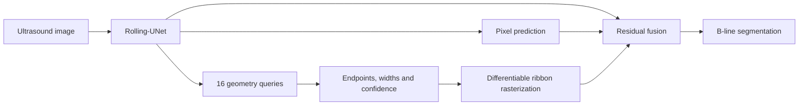

# B-GeoNet

**Geometry-guided B-line segmentation in lung ultrasound.**

B-GeoNet combines a Rolling-UNet pixel pathway with learnable B-line geometry queries. Each query describes a ribbon using two endpoints and two widths. A differentiable rasterizer converts these predictions into a spatial prior, which guides the final segmentation through a residual fusion head.

| Model | Parameters | Input | Geometry |
| --- | ---: | --- | --- |
| B-GeoNet | 2,599,897 | 512 × 512 grayscale | 16 queries × 6 parameters |

The CUDA inference runtime uses vectorized Rolling operations, fixed coordinate grids, compiled rasterization and fusion modules, and CUDA Graph execution. The accompanying benchmark provides model-specific training routes and a common evaluation interface for **36 comparison models**.



## Installation

Use Python 3.11 and a CUDA-capable PyTorch environment. Run commands from the repository root.

```bash
python -m pip install -r requirements.txt
```

Additional benchmark dependencies and model repositories are described in [Benchmark guide](docs/benchmark.md).

## Train B-GeoNet

Place 512 × 512 PNG images and single-channel binary masks under the following structure. Image and mask filenames must match; foreground labels are `1` and background labels are `0`.

```text
data/Size_512/
  train/images/    train/masks/
  val/images/      val/masks/
  test/images/     test/masks/
```

```bash
python -m bgeonet.prepare data/Size_512 outputs/geometry.json
python -m bgeonet.train --root data/Size_512 --metadata outputs/geometry.json \
  --output outputs/bgeonet --batch-size 32
```

The geometry preparation step uses training and validation masks. Training saves `best.pth`, `last.pth`, per-epoch history and optimizer, scheduler and random-number states. Resume with the same settings and `--resume outputs/bgeonet/last.pth`.

## Evaluate

```bash
python -m benchmarks.evaluate --model bgeonet \
  --checkpoint outputs/bgeonet/best.pth \
  --images data/Size_512/test/images --masks data/Size_512/test/masks \
  --output outputs/bgeonet_test
```

The runtime uses CUDA, BF16 network operations and FP32 geometry. Add `--eager` to run without module compilation and graph capture. Add `--postprocess centerline100` to also report the B-line centerline-length postprocessing condition.

Each run produces **59 aggregate metrics**, a complete `test_cases.csv`, lesion-level records and an input checksum manifest. Dice and IoU are image means; lesion precision, recall and F1 use pooled one-to-one matching at strict IoU > 0.2, 0.3 and 0.5. Standard deviations use the population convention.

## Model and benchmark documentation

- [Architecture and loss design](docs/architecture.md)
- [36-model benchmark and dependencies](docs/benchmark.md)
- [Evaluation and inference timing](docs/protocol.md)
- [Third-party acknowledgments](THIRD_PARTY.md)

## Source layout

| Directory | Contents |
| --- | --- |
| `bgeonet/` | Model, geometry supervision, training and inference runtime |
| `benchmarks/` | Common evaluator, 36-model registry and native adapters |
| `experiments/` | Model-family training implementations |
| `evaluation/` | Native architecture builders and supporting evaluators |
| `metrics/` | Pixel, boundary, topology and lesion metrics |
| `configs/` | B-GeoNet training settings |
| `tests/` | Raster, Rolling operation and metric checks |
